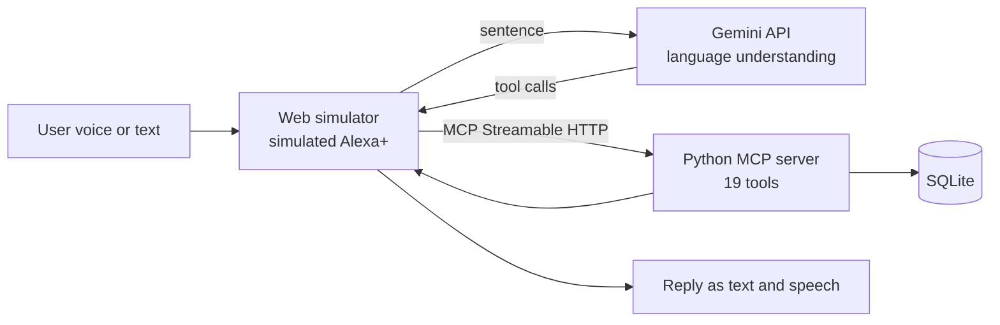

# SpendWise Voice

**Just say it. SpendWise Voice tracks your expenses by voice, understands English, Urdu and Hindi, warns you before you overspend, and speaks a weekly summary.**

Built for the *Build, Ship, Shape: Amazon Developer Hackathon* (Alexa+ track).

## What it is
SpendWise Voice is a Python **MCP server** with 19 expense tools, plus a web-based **simulated Alexa+ experience** to talk to it by voice or text.

> **Note:** The Alexa+ experience in this demo is simulated. In the simulator, a Gemini model turns the user's sentence into MCP tool calls. In real Alexa+, language understanding is done by Alexa+ itself, and our MCP server only exposes the tools.

## Features
- **Natural language:** English, Urdu, Hindi, Roman Urdu or a mix; several actions in one sentence
- **Expenses:** add (today, yesterday or any date), edit, delete with confirmation, list recent
- **Analytics:** totals by day/week/month/custom range, top category, month comparison, insights, weekly spoken summary
- **Budgets:** monthly limits, warnings at 80% and when exceeded, "how much is left"
- **Recurring bills:** monthly reminder, added only after the user says yes; skip a month or remove a bill; keeps reminding until the user decides
- **Dashboard:** live spending by category
- **Voice:** mic input and spoken replies; every reply shows which MCP tool ran
- **Resilience:** retries and a backup model when Gemini is busy, friendly errors, input validation

## MCP tools
| Area | Tools |
|---|---|
| Expenses | `add_expense`, `edit_expense`, `delete_expense`, `delete_last_expense`, `list_recent_expenses` |
| Analytics | `get_total`, `top_category`, `compare_months`, `get_insights`, `weekly_summary`, `category_breakdown` |
| Budgets | `set_budget`, `get_budget_status` |
| Recurring | `add_recurring`, `list_recurring`, `recurring_reminder`, `confirm_recurring`, `skip_recurring`, `remove_recurring` |

## Architecture


## Tech stack
Python, MCP Python SDK 1.x (Streamable HTTP), SQLite, Starlette, Uvicorn, JavaScript (Web Speech API), Gemini API

## Run locally
**Requirements:** Python 3.10+, Chrome or Edge, a Gemini API key from Google AI Studio.

```bash
git clone https://github.com/rabiakhaliq-cs/spendwise-voice.git
cd spendwise-voice
python -m venv venv
venv\Scripts\activate          # Mac/Linux: source venv/bin/activate
pip install -r requirements.txt
```

Create a `.env` file (see `.env.example`):
```
GEMINI_API_KEY=your_key
GEMINI_MODEL=your_main_model
GEMINI_FALLBACK_MODELS=your_backup_model
```
Use `python list_models.py` to see which models your key can use.

Run in two terminals:
```bash
python server.py     # MCP server on http://127.0.0.1:8000/mcp
python app.py        # Simulator on http://127.0.0.1:5000
```
Open http://127.0.0.1:5000 in Chrome or Edge.

## Try these
- `maine aaj 500 rupay khane pe kharch kiye`
- `kal 300 petrol pe lage`
- `set food budget to 1000`, then `mera food budget kitna bacha hai?`
- `where did I spend the most this month?`
- `1200 wala hata do`, then `haan`
- `add internet bill 2500 every month on the 1st`, then `yes`
- `give me my weekly summary`

## Design principles
Based on the Alexa+ customer experience principles: tasks finish by voice, every action is confirmed, minimal data is used, and errors always give a clear next step. Deleting always asks for confirmation, and recurring bills are never added without the user's OK.

## Limitations
- The Alexa+ experience is simulated. Real add-on deployment needs MCP Toolkit access and OAuth 2.1 account linking
- Single demo user, so per-user data comes with account linking
- The simulator needs internet and the Gemini API for language understanding
- Reminders appear when the app is open; proactive voice reminders need Alexa+ routines
- Some logic is rule-based: fallback category guessing, insight tips and budget thresholds

## Future work
Real Alexa+ add-on, proactive reminders, cloud database, AI-generated insights, savings goals, family budgets, receipt scanning, bank SMS import, Echo Show visuals via MCP Apps.